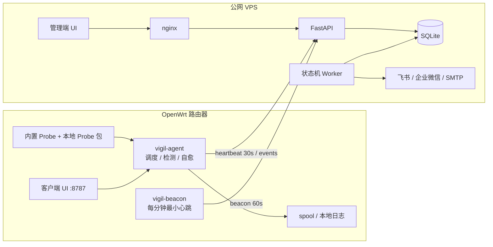

# Vigil

**Vigil（守夜）** 是一套面向 OpenWrt 及其衍生发行版的服务监测与自愈系统。

它把「判断」放在路由器本地：即使外网已经断开，客户端仍能完成检测、按策略执行低风险恢复动作；服务端只做旁路观察、失联判定、告警通知与证据归档，从不下发可执行代码。


## 目录

- [为什么需要 Vigil](#为什么需要-vigil)
- [核心特性](#核心特性)
- [系统架构](#系统架构)
- [检测模型](#检测模型)
- [快速开始](#快速开始)
- [配置参考](#配置参考)
- [开发](#开发)
- [部署与运维](#部署与运维)
- [安全设计](#安全设计)
- [API 概览](#api-概览)
- [路线图](#路线图)
- [贡献](#贡献)
- [许可证](#许可证)

## 为什么需要 Vigil

路由器故障时，常见的监控方案有三个难题：

1. **断网时告警发不出去**。依赖云端轮询或本地推送的监控，在 WAN 中断时往往一起失联。
2. **只告警，不自愈**。半夜断网需要人工介入，恢复时间取决于是否有人看到通知。
3. **远程下发脚本风险高**。为了自愈而开放云端命令通道，等于把路由器控制权交给远端。

Vigil 的取舍是：

- **客户端自治**：检测、判定、恢复都在本地完成，断网不影响核心能力。
- **服务端旁路**：服务端只看心跳与证据，负责「客户端没恢复时」的告警。
- **可插拔、可审计**：检测能力由 Probe 组合而成，自定义 probe 只能本地安装。

## 核心特性

- **双通道失联判定**：客户端每 30 秒上报心跳，独立于 agent 的 beacon 每分钟上报一次。服务端据此区分「agent 崩溃」「主机/网络故障」与正常静默。
- **分层检测链路**：`Probe → Observation → Expectation → Check → Guard`，同一轮检测中每个 Check 只执行一次，多个 Guard 可共享结果。
- **本地自愈**：Guard 触发后执行 L1 软恢复动作（`ifup_wan`、重启白名单服务），动作后自动复检；带冷却、每小时上限与放弃条件。
- **可插拔探测器**：内置 `carrier`、`pppoe`、`route`、`dns`、`http`、`tcp`、`icmp`、`process`、`command` 等 probe；支持本地 probe 包（manifest + SHA-256 + tar.gz）。
- **检测项与守护项本地管理**：Check / Guard 全部保存在客户端 `/etc/vigil/config.json`，可在客户端 UI 编辑并即时生效；服务端只读展示心跳快照与 probe 目录。
- **双端 Web UI**：Vue 3 + TypeScript + SCSS。客户端 UI 内置在 agent 中，服务端 UI 由 nginx 托管。
- **通知渠道**：飞书、企业微信、SMTP 邮件；支持测试发送、失败重试与死信记录。
- **断网补传**：客户端把事件写入 spool，恢复联网后批量补传；服务端按事件 ID 幂等去重。
- **轻量部署**：agent 运行时仅依赖 Python 标准库，安装包 arch = `all` / `noarch`；服务端单机 SQLite + systemd。

## 系统架构



数据流：

1. **正常**：agent 上报心跳（检测项、探测器与守护项快照），beacon 上报最小心跳。
2. **断网**：心跳与 beacon 同时中断；agent 在本地继续检测，把事件、动作与证据写入 spool。
3. **判定**：服务端心跳静默超过 90 秒进入 `SUSPECT`，超过 150 秒进入 `DOWN`，并按通知配置推送告警。
4. **自愈**：客户端按 Guard 策略执行恢复链，动作后复用下一轮 Check 结果复检。
5. **恢复**：心跳恢复后客户端补传事件，服务端标记 `RECOVERED` 并推送恢复通知。

> 短暂断网在服务端阈值内自愈时不会发送告警，这是为了避免抖动噪声。

## 检测模型

| 概念 | 说明 |
| --- | --- |
| Probe | 可复用的纯检测能力，只负责观测，返回 Observation |
| Observation | `data` + `latency_ms` + `error` |
| Expectation | 根据 Observation 得出 `ok` / `critical` / `unknown` |
| Check | `probe + params + expect + timeout + depends_on` 的命名实体 |
| Guard | 完整监控单元：Check 引用 + 触发策略 + 恢复动作，UI 中显示为「服务」 |
| Policy | 连续失败次数、窗口、恢复确认、冷却、每小时上限、放弃条件 |
| Action | 全局动作库中的恢复动作，包含风险等级与复检方式 |

一个 Check：

```json
{
  "id": "api-health",
  "name": "业务 API",
  "probe": "http",
  "params": { "url": "http://127.0.0.1:8080/health", "method": "GET" },
  "expect": { "kind": "http", "status": [200], "body_contains": "ok" },
  "timeout": 5,
  "depends_on": ["wan-link"],
  "enabled": true
}
```

一个 Guard：

```json
{
  "id": "6f2c1a4e-9b7d-4c3a-8e51-2d4b6a8f0c37",
  "name": "断网自动恢复",
  "template": "network.up",
  "enabled": true,
  "check_refs": ["wan-link", "pppoe-session", "default-route", "dns", "http204"],
  "evaluate": { "mode": "dependency_tree", "quorum": 1 },
  "policy": {
    "interval": 30,
    "fail_threshold": 2,
    "fail_mode": "consecutive",
    "fail_window": 90,
    "success_threshold": 1,
    "cooldown": 300,
    "max_actions_per_hour": 3,
    "gave_up_after": 3
  },
  "recovery": [{ "action": "ifup_wan", "verify_after": 20 }],
  "limits": { "max_risk_level": "L1" }
}
```

约定：

- `id` 在单客户端内唯一，格式 `^[a-z0-9][a-z0-9._-]{0,63}$`。
- `depends_on` / `check_refs` 必须引用已存在的 Check，禁止自依赖与循环依赖。
- `command` probe 为本地专用，服务端配置不可引用。
- Check 与 Guard 由客户端本地保存与校验，服务端只下发运行时策略（阈值、动作开关等）。

## 快速开始

### 环境要求

| 组件 | 要求 |
| --- | --- |
| 路由器 | OpenWrt 22.03+（含 23.05 / 24.10、iStoreOS、ImmortalWrt 等） |
| 客户端依赖 | `python3-light`、`python3-urllib`、`python3-openssl` |
| 服务端 | Linux VPS，Python 3.12（推荐 [uv](https://github.com/astral-sh/uv)），SQLite |
| 前端开发 | Node.js >= 20，npm |
| 可选 | nginx、systemd |

### 1. 启动服务端

```bash
git clone https://github.com/li9633/vigil.git
cd vigil/server

uv sync
cp .env.example .env
# 至少修改：VIGIL_BOOTSTRAP_TOKEN、VIGIL_SESSION_SECRET
# 生产环境还需设置 VIGIL_ADMIN_KEY_FILE、VIGIL_DATABASE_URL 等

uv run uvicorn app.main:app --host 127.0.0.1 --port 8000
# 另开一个终端启动状态机 worker
uv run python -m app.worker
```

首次启动会生成随机管理员初始密码，默认写入数据目录的 `initial_admin_password`（0600）；登录 Web 后请立即修改密码。

服务端 UI 开发模式：

```bash
cd web
npm install
npm run dev:server-ui
```

### 2. 安装客户端

在仓库根目录构建 OpenWrt 安装包：

```bash
python scripts/package.py
# 产物：dist/vigil-agent_<version>_all.ipk
#       dist/vigil-agent_<version>_noarch.apk
```

上传到路由器并安装：

```bash
# opkg 系统
opkg install /tmp/vigil-agent_<version>_all.ipk

# apk 系统
apk add --allow-untrusted /tmp/vigil-agent_<version>_noarch.apk
```

编辑 `/etc/vigil/config.json`，至少填写服务端地址与一次性引导令牌：

```json
{
  "schema_version": 3,
  "server": {
    "base_url": "http://vigil.example.com:5000",
    "bootstrap_token": "<服务端 VIGIL_BOOTSTRAP_TOKEN>",
    "heartbeat_interval": 30,
    "config_poll_interval": 300,
    "verify_tls": true
  },
  "httpd": {
    "bind": "0.0.0.0",
    "port": 8787,
    "token": "<客户端 UI 管理员令牌>"
  }
}
```

重启服务：

```bash
/etc/init.d/vigil enable
/etc/init.d/vigil restart
```

agent 会使用 bootstrap token 自动注册，并把服务端返回的 `client_id` / `secret` 写回本地配置。随后可访问客户端 UI：

```text
http://<路由器 LAN IP>:8787
```

安装包的 postinst 会自动注册 beacon cron、放行 LAN 8787 防火墙规则；升级时 `/etc/vigil/config.json` 受 conffiles / protected_paths 保护，不会被覆盖。

### 3. 配置通知

登录服务端 UI，在「通知配置」中选择飞书、企业微信或邮件，填写参数后点击「测试发送」验证通道。

- 飞书 / 企业微信：填写 Webhook 地址。
- 邮件：填写 SMTP 主机、端口、账号、授权码、发件人与收件人。
- 通知默认限频为每小时 10 条，可在配置中调整。

## 配置参考

### 客户端关键配置

| 配置项 | 说明 |
| --- | --- |
| `schema_version` | 必须为 `3` |
| `server.base_url` | 服务端地址 |
| `server.bootstrap_token` | 首次注册用一次性令牌，注册成功后可留空 |
| `server.client_id` / `server.secret` | 注册后自动写入的客户端凭据 |
| `server.verify_tls` | 是否校验证书，HTTPS 环境应保持 `true` |
| `checks` | 检测项列表，本地管理 |
| `guards` | 守护项列表，本地管理 |
| `action_safety.global_enabled` | 全局动作开关 |
| `action_safety.max_risk_level` | 允许的最高风险等级，当前仅支持 `L1` |
| `action.allowed_services` | 允许 `restart_service` 的服务白名单，默认 `dnsmasq` |
| `httpd.token` | 客户端 UI 登录令牌 |
| `storage.*` | state、spool、日志与锁文件路径 |
| `probes.dir` | 本地 probe 包目录，默认 `/etc/vigil/probes.d` |

环境变量可覆盖常用配置，例如 `VIGIL_SERVER_BASE_URL`、`VIGIL_SERVER_BOOTSTRAP_TOKEN`、`VIGIL_HTTPD_TOKEN`、`VIGIL_ACTION_ENABLED`。

### 服务端关键环境变量

| 变量 | 默认值 | 说明 |
| --- | --- | --- |
| `VIGIL_DATABASE_URL` | `sqlite+pysqlite:///./vigil.db` | 数据库连接 |
| `VIGIL_BOOTSTRAP_TOKEN` | `vigil-bootstrap-dev` | 客户端注册引导令牌，生产必须修改 |
| `VIGIL_ADMIN_USERNAME` | `admin` | 管理员用户名 |
| `VIGIL_ADMIN_KEY_FILE` | `/var/lib/vigil/admin.key` | 密码哈希 pepper 文件 |
| `VIGIL_SESSION_SECRET` | `vigil-dev-session-secret-change-me` | 会话签名密钥，生产必须修改 |
| `VIGIL_HEARTBEAT_INTERVAL` | `30` | 期望心跳间隔（秒） |
| `VIGIL_SUSPECT_SECONDS` | `90` | 进入 `SUSPECT` 的静默阈值 |
| `VIGIL_DOWN_SECONDS` | `150` | 进入 `DOWN` 的静默阈值 |
| `VIGIL_BEACON_SECONDS` | `180` | beacon 超时阈值 |
| `VIGIL_ACTIONS_ENABLED` | `true` | 是否允许客户端执行 L1 动作 |
| `VIGIL_ACTION_COOLDOWN_SECONDS` | `300` | 单动作冷却时间 |
| `VIGIL_ACTION_MAX_PER_HOUR` | `3` | 每小时动作上限 |
| `VIGIL_RETENTION_DAYS` | `30` | 明细数据保留天数 |
| `VIGIL_DISK_ALERT_PERCENT` | `85` | 数据盘水位告警阈值 |

完整列表见 [`server/.env.example`](server/.env.example)。

## 开发

### 项目结构

```text
vigil/
├── agent/                  # OpenWrt 客户端（运行时仅标准库）
│   ├── vigil_agent/        # 调度、探测、检测、守护、动作、API
│   ├── beacon/             # 独立最小心跳脚本
│   └── tests/
├── server/                 # FastAPI 服务端
│   ├── app/                # API、服务、仓储、状态机、通知适配
│   ├── deploy/             # systemd / nginx / vigil-admin 模板
│   └── tests/
├── web/                    # npm workspaces
│   ├── shared/             # 共享组件、类型与样式
│   ├── server-ui/          # 管理端
│   └── client-ui/          # 客户端 UI
└── scripts/                # 部署、打包与演练脚本
```

### 常用命令

```bash
# 服务端
cd server
uv sync
uv run uvicorn app.main:app --reload
uv run pytest -q
uv run ruff check .
uv run mypy

# 客户端（Python 3.9 兼容，仅标准库）
cd agent
python -m unittest discover -s tests -q
uv run ruff check .
uv run mypy

# 前端
cd web
npm install
npm run dev:server-ui
npm run dev:client-ui
npm run build
```

### 一键部署（开发通道）

复制 [`scripts/deploy.example.json`](scripts/deploy.example.json) 为 `scripts/deploy.local.json`，填写 SSH 连接信息：

```json
{
  "client": { "ssh": "openwrt", "user": "", "port": null, "key": "" },
  "server": {
    "host": "vps.example.com",
    "user": "root",
    "port": 22,
    "key": "~/.ssh/id_ed25519"
  }
}
```

```bash
python scripts/deploy.py client      # 只部署路由器
python scripts/deploy.py server      # 只部署服务端
python scripts/deploy.py all         # 两端都部署

# 可选参数
--no-tests     # 跳过单元测试
--no-build     # 跳过前端构建
--dry-run      # 只打印命令
--keep-remote  # 保留远端临时包
```

`deploy.py` 是开发通道，会把当前代码直接覆盖到测试设备；正式交付请使用 `scripts/package.py` 构建安装包。`deploy.local.json` 已在 `.gitignore` 中，禁止提交。

## 部署与运维

服务端默认布局：

| 路径 | 用途 |
| --- | --- |
| `/opt/vigil` | 服务端代码与虚拟环境 |
| `/var/www/vigil` | 服务端 UI 静态资源 |
| `/var/lib/vigil` | SQLite、日志、`admin.key`、初始密码文件 |
| `/etc/vigil/server.env` | 服务端环境变量 |

`server/deploy/` 提供：

- `vigil-api.service`：API，仅监听 `127.0.0.1:8000`
- `vigil-worker.service`：状态机、通知、保留清理与磁盘水位检查
- `nginx-vigil.conf` / `nginx-vigil-http.conf`：SPA 托管与 `/api` 反向代理
- `vigil-admin`：管理员维护命令

```bash
vigil-admin status
vigil-admin reset-password   # 保留密钥，随机生成新密码并打印一次
vigil-admin reset-key        # 轮换密钥并重置密码，旧密码失效
```

升级与回滚：

- 部署脚本会保留上一版本目录（`*.old`），异常时可回滚。
- 客户端升级不覆盖 `/etc/vigil/config.json`。
- 健康检查：服务端 `/healthz`，客户端 `:8787/`。

## 安全设计

- **客户端身份**：独立 secret + Bearer 鉴权，服务端仅保存 SHA-256；请求带时间窗（±300 秒）与 nonce，防重放。
- **管理员身份**：密码使用 PBKDF2-HMAC-SHA256（300,000 次迭代）+ 随机 pepper；pepper 与数据库分文件保存，数据库泄露时无法离线校验。
- **初始凭据**：首次启动随机生成，写入 0600 文件；修改密码后删除，不通过环境变量注入管理员密码。
- **代码分发**：服务端从不下发可执行文件；自定义 probe 只能本地安装，且每次执行前校验 manifest 与 SHA-256。
- **远端配置边界**：服务端只下发运行时策略（阈值、动作开关等），不包含检测项与守护项；`command` probe 仅限本地。
- **动作安全**：仅白名单动作、最高 L1；全局开关、冷却、每小时上限、审计日志与维护窗口共同约束。
- **最小权限**：服务端 systemd 使用 `NoNewPrivileges`、`ProtectSystem=strict`、`PrivateTmp`，仅 `/var/lib/vigil` 可写。

生产部署建议：

1. 修改所有默认令牌与密钥。
2. 将服务端放在 HTTPS 之后（nginx / Caddy），客户端保持 `verify_tls: true`。
3. 限制管理端仅对可信来源开放。
4. 不要把 `scripts/deploy.local.json`、`dist/config.json`、数据库或日志提交到仓库。

## API 概览

客户端上行（Bearer 鉴权）：

| 方法 | 路径 | 说明 |
| --- | --- | --- |
| `POST` | `/api/v1/register` | 使用 `X-Vigil-Bootstrap` 换取 `client_id` / `secret` |
| `POST` | `/api/v1/heartbeat` | 心跳、检测项与守护项快照 |
| `POST` | `/api/v1/beacon` | 最小心跳 |
| `POST` | `/api/v1/events` | 事件批量上报与补传 |
| `GET` | `/api/v1/config` | 拉取运行时策略（ETag 协商） |

客户端本地 API（管理员会话）：

| 方法 | 路径 | 说明 |
| --- | --- | --- |
| `GET` / `PUT` | `/api/checks` | 查看 / 保存检测项 |
| `GET` / `PUT` | `/api/guards` | 查看 / 保存守护项 |
| `GET` / `POST` | `/api/probes` | 探测器目录 / 安装本地 probe 包 |
| `POST` | `/api/probes/{id}/test` | 试运行本地 probe |

管理端 API 位于 `/api/v1/admin`，使用 HttpOnly Cookie 会话。

## 路线图

- [ ] HTTPS / TLS 正式部署与证书校验默认化
- [ ] Docker / Compose 部署
- [ ] LuCI 菜单入口
- [ ] 检测项 / 守护项模板库与导入导出
- [ ] 多管理员、角色权限与多站点分组
- [ ] 外部 dead-man's-switch 集成
- [ ] agent 自动升级

## 贡献

欢迎提交 Issue 和 Pull Request。

1. Fork 本仓库并从 `main` 创建分支。
2. 保持改动聚焦，补充或更新对应测试。
3. 提交前运行相关检查：

```bash
# 服务端
cd server && uv run pytest -q && uv run ruff check . && uv run mypy

# 客户端
cd agent && python -m unittest discover -s tests -q && uv run ruff check . && uv run mypy

# 前端
cd web && npm run build
```

4. 提交信息建议使用 `feat:`、`fix:`、`docs:`、`chore:` 等前缀，描述使用中文。
5. 禁止提交任何真实凭证、私钥、内网地址或个人信息。

## 许可证

本项目采用 [MIT License](LICENSE) 开源。

你可以自由使用、修改、分发和商用，包括闭源分发；请保留版权声明与许可证文本。软件按「现状」提供，不附带任何明示或暗示的担保。
